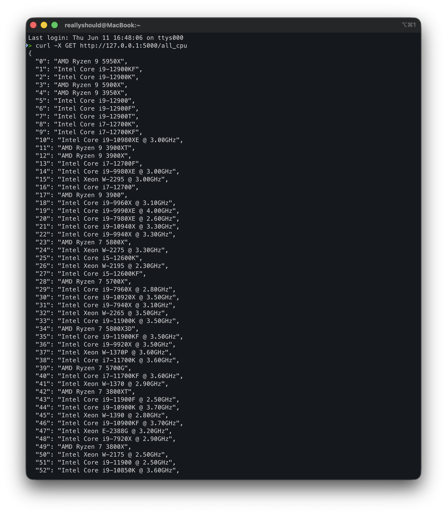

# PC Builder API


## Пример использования автосборщика
curl -X POST http://127.0.0.1:5000/build -H "Content-Type: application/json" -d '{"price": "50000", "cfg": "Gaming"}'

### Вывод


## Отдельная часть в зависимости от уже установленных

---

#### `GET` `/filter_mb` — Фильтрация материнских плат
Получить список совместимых материнских плат на основе текущей конфигурации.

*   **Parameters (Query):**
    *   `MB` (string) — Модель текущей платы.
    *   `CPU` (integer) — ID выбранного процессора.
    *   `GPU` (integer) — ID выбранной видеокарты.
    *   `RAM` (integer) — ID выбранной оперативной памяти.
    *   `PSU` (string) — Модель или мощность БП.

---

#### `GET` `/filter_cpu` — Фильтрация процессоров
Получить список совместимых процессоров на основе текущей конфигурации.

*   **Parameters (Query):**
    *   `MB` (string) — Модель текущей платы.
    *   `CPU` (integer) — ID выбранного процессора.
    *   `GPU` (integer) — ID выбранной видеокарты.
    *   `RAM` (integer) — ID выбранной оперативной памяти.
    *   `PSU` (string) — Модель или мощность БП.

---

#### `GET` `/filter_gpu` — Фильтрация видеокарт
Получить список подходящих видеокарт на основе текущей конфигурации.

*   **Parameters (Query):**
    *   `MB` (string) — Модель текущей платы.
    *   `CPU` (integer) — ID выбранного процессора.
    *   `GPU` (integer) — ID выбранной видеокарты.
    *   `RAM` (integer) — ID выбранной оперативной памяти.
    *   `PSU` (string) — Модель или мощность БП.

---

#### `GET` `/filter_ram` — Фильтрация оперативной памяти
Получить список совместимой ОЗУ на основе текущей конфигурации.

*   **Parameters (Query):**
    *   `MB` (string) — Модель текущей платы.
    *   `CPU` (integer) — ID выбранного процессора.
    *   `GPU` (integer) — ID выбранной видеокарты.
    *   `RAM` (integer) — ID выбранной оперативной памяти.
    *   `PSU` (string) — Модель или мощность БП.

---

#### `GET` `/filter_psu` — Фильтрация блоков питания
Получить список подходящих БП на основе текущей конфигурации.

*   **Parameters (Query):**
    *   `MB` (string) — Модель текущей платы.
    *   `CPU` (integer) — ID выбранного процессора.
    *   `GPU` (integer) — ID выбранной видеокарты.
    *   `RAM` (integer) — ID выбранной оперативной памяти.
    *   `PSU` (string) — Модель или мощность БП.


### Примеры
#### Фильтрация по определенным компонентам:
```bash
curl -X GET http://127.0.0.1:5000/filter_mb -H "Content-Type: application/json" -d '{"MB": "None", "CPU": 1, "GPU": 7, "RAM": 0, "PSU": "None"}'
```
```bash
curl -X GET http://127.0.0.1:5000/filter_cpu -H "Content-Type: application/json" -d '{"MB": 15, "CPU": "None", "GPU": "None", "RAM": "None", "PSU": "None"}'
```
```bash
curl -X GET http://127.0.0.1:5000/filter_ram -H "Content-Type: application/json" -d '{"MB": 0, "CPU": 157, "GPU": 70, "RAM": "None", "PSU": 2}'
```
```bash
curl -X GET http://127.0.0.1:5000/get_id_by_name -H "Content-Type: application/json" -d '{"name": "Samsung SSD 980 PRO 1TB"}'
```
### Вывод

## Перечень всего что есть

---

#### `GET` `/all_mb` — Получить все материнские платы
Получить полный список всех доступных в базе данных материнских плат без фильтрации.

*   **Parameters (Query):**
    *   *Параметры отсутствуют*

---

#### `GET` `/all_cpu` — Получить все процессоры
Получить полный список всех доступных в базе данных процессоров без фильтрации.

*   **Parameters (Query):**
    *   *Параметры отсутствуют*

---

#### `GET` `/all_gpu` — Получить все видеокарты
Получить полный список всех доступных в базе данных видеокарт без фильтрации.

*   **Parameters (Query):**
    *   *Параметры отсутствуют*

---

#### `GET` `/all_ram` — Получить всю оперативную память
Получить полный список всех доступных в базе данных модулей ОЗУ без фильтрации.

*   **Parameters (Query):**
    *   *Параметры отсутствуют*

---

#### `GET` `/all_psu` — Получить все блоки питания
Получить полный список всех доступных в базе данных блоков питания без фильтрации.

*   **Parameters (Query):**
    *   *Параметры отсутствуют*

### Вывод

---
